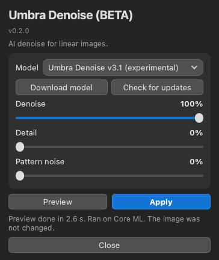
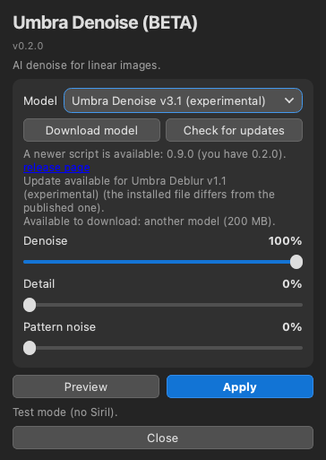

# Umbra Denoise (BETA)

Umbra Denoise is an AI noise remover for linear images in [Siril](https://siril.org). It is a Siril Python script with an AI model. It runs locally on your computer and is free. It was trained for small-scope stacks (Seestar, Dwarf and similar) and also works on DSLR and mono data.

**Status: Beta (v0.2.0).** Expect rough edges.

## Download and install

1. Download the single file [`Umbra_Denoise.py`](https://raw.githubusercontent.com/Kishanhpatel/umbra-denoise/main/Umbra_Denoise.py) (also attached to the [latest release](https://github.com/Kishanhpatel/umbra-denoise/releases/latest)). Save it in any folder you like. Siril has no standard scripts folder name.
2. In Siril open **Preferences > Scripts**, add that folder, refresh the list, then run **Umbra Denoise** from the Scripts menu.
3. First run: Siril installs the Python packages the script needs (numpy, onnxruntime, PyQt6, scipy, astropy). This can take a few minutes.
4. If no model is installed, press **Download model** (Umbra Denoise v3.1 (experimental), about 100 MB). The file is checked with SHA-256 and saved in a folder named `Umbra Denoise` next to the script.

**Manual install.** Download the `.onnx` file from the [release page](https://github.com/Kishanhpatel/umbra-denoise/releases/latest) and put it in the `Umbra Denoise` folder next to the script. To use another folder, set `UMBRA_DENOISE_MODEL_DIR` to it. `UMBRA_DENOISE_MODEL` can point at one specific model file.

**Updates.** **Check for updates** compares your installed models and the script version with the published list (`models/models.json`). A new or changed model downloads only when you press the button. A newer script is shown as a link to the release page; the script never replaces itself. Nothing is sent about you or your computer (only a generic client name). With no network the installed models keep working. Set `UMBRA_DENOISE_OFFLINE=1` (or `UMBRA_OFFLINE=1`) to turn the lookup off.

## What it does

The model removes noise and leaves levels and colours above about 32 px untouched. Controls:

- **Denoise** (0 to 100%, default 100): how much noise is removed. 0 turns it off (Pattern noise can still run alone).
- **Detail** (0 to 100%, default 0): gives back part of what Denoise removed, split by scale. Faint mottled structure (nebula texture, outer halos) comes back together with a little grain. 0 is full noise removal. 25 to 50 suits faint, low-contrast targets.
- **Pattern noise** (0 to 100%, default 0): for blotchy mottle that repeats in every sub (calibration problems, no dithering). Random noise is handled by Denoise. Pattern noise cannot be told apart from real faint signal with certainty, so it may remove some. Leave it at 0 unless you see blotches. It works without Denoise.

Saturated stars are protected so their shapes are not changed.

**Preview.** The **Preview** button opens a separate, resizable window. It shows a region of the image before and after (same stretch for both): your current Siril selection if it is at least 64 px, otherwise a centred 768 x 768 crop (the whole image if smaller). Small selections are processed with some surrounding image for context, then cropped back. Hold down **Show original** (or the Space key) to see the original; release it to see the result again. It never changes the image in Siril.

**Apply.** **Apply** replaces the image in Siril with the result. Use Siril's **Undo** to go back. Siril's scripting interface cannot write a FITS HISTORY line, so the settings used are written to the Siril log (and into any extra FITS file the tool saves).

**Command line.** `python Umbra_Denoise.py --image IN.fits --out OUT.fits` runs the tool without a window. Flags: `--denoise 0..1`, `--detail 0..1`, `--pattern 0..1`, `--model PATH`. `--check-updates` and `--download [MODEL_ID|all]` work from the command line too, and `--help` lists everything.

## Models

Since v0.2.0 the model files store their weights at half size (16-bit) and compute in full 32-bit precision, so the results are bit-identical to the larger v0.1.x files. If you already have the larger file it keeps working and is not downloaded again.

Models are published as GitHub release assets and are not stored in this repository. See `models/models.json`.

| Name | File | Size | Notes |
|---|---|---|---|
| Umbra Denoise v3.1 (experimental) (default, only model) | `umbra_denoise_v3.1_experimental.onnx` | 100 MB | Keeps faint structure well. Star cores can come out about 1% brighter (see Weaknesses). |

## Strengths

- Designed to keep small dark globules, dust lanes and filaments instead of smoothing them away.
- Keeps about 93% of faint (1 to 3 sigma) structure on native stacks at matched noise.
- Takes a noise description of the image as input, so Seestar and Dwarf noise (about twice the measured fine-scale noise) and DSLR or mono noise are both handled. Drizzle-like noise is handled too.
- Does not move levels or colours at scales above about 32 px, so it cannot shift your background colour.
- The Detail slider lets you trade noise removal for texture. Pattern noise removal is optional.
- Mono and already-clean inputs pass the checks (a clean image stays nearly unchanged).

## Weaknesses

- Star cores at 20 to 60 sigma come out about 1% brighter, with no ring or halo and a colour change under 1%. It is invisible to the eye, but it is why this model is called experimental. Do not use it for photometry.
- Some very faint structure is still smoothed. Raise Detail if your target is faint and low-contrast.
- Pattern noise cannot be separated from faint real signal for certain. It can remove some real signal.
- Linear data only.
- Images smaller than 512 px on a side differ a little from the original PyTorch version (see Testing).
- Tested mainly on the author's own data and one Mac.

## GPU acceleration

The GPU is used by default whenever one can be used, and the CPU only as a fallback. Providers are tried in this order: CUDA (NVIDIA), DirectML (Windows), ROCm and MIGraphX (AMD on Linux), OpenVINO (Intel), Core ML (Mac), then CPU. Each one is checked against the CPU result on a small probe tile before it is used; if it fails or the result differs, the script falls back to the CPU. The status line says which one ran ("Ran on ..."). Set `UMBRA_DENOISE_CPU=1` to force the CPU.

On first run the script installs the onnxruntime package that gives your system a GPU:

- **Mac:** `onnxruntime` (Core ML, Apple GPU, built in).
- **Windows:** `onnxruntime-directml` (any DirectX 12 GPU: NVIDIA, AMD or Intel; no extra downloads).
- **Linux with an NVIDIA GPU:** `onnxruntime-gpu` (CUDA). If the system has no CUDA 12 / cuDNN 9 libraries, NVIDIA's own pip packages of them are installed too (a one-time download of about 2 to 3 GB).
- **Linux with AMD or Intel graphics:** there is no GPU build that installs automatically, so these run on the CPU. If you install `onnxruntime-rocm`, `onnxruntime-migraphx` or `onnxruntime-openvino` yourself in Siril's Python, the script uses it.

## Testing

Be aware of what has and has not been tried. This is a beta.

Tested:
- macOS 26 on an Apple M3, with Core ML and with the CPU.
- Standalone (command line and window test) and inside Siril 1.4.5 run headless (`siril-cli` with `pyscript`): read the image, process it, write it back with an Undo state, save.
- The window was tested offscreen only.

NOT tested:
- Windows and Linux.
- CUDA, DirectML and ROCm (the code is written; please report what you see).
- Intel Macs.
- The interactive window inside the Siril GUI.

Parity with the original PyTorch version: the network matches to about 1e-6 relative. The whole pipeline matches to at most 0.001 noise sigma on real frames (up to 3 x 2048 px, with saturated stars, mono, and a NaN hole), against a typical change of about 1 to 2 sigma. Core ML and CPU agree.
Small images: the model uses fixed 512 px tiles and its attention depends on the tile size, so images under 512 px differ from PyTorch by up to about 1.2 sigma at a pixel (typically 0.01 to 0.08 sigma rms, against a change of about 1.9 sigma). This cannot be removed exactly with the fixed-size file. Images 512 px or larger are not affected.

## Layout

- `Umbra_Denoise.py`: the script (v0.2.0, ONNX Runtime, with model download and update check)
- `models/models.json`: model manifest (name, version, download URL, SHA-256, size)
- `docs/screenshots/`: panel screenshots
- `LICENSE`, `LICENSE-MODELS.md`: licenses

## Contact

Bugs or questions: umbraastrolabs@gmail.com, or open an issue on GitHub.

## License

- Script: GPL-3.0-only (see `LICENSE`).
- Models: CC BY-NC-SA 4.0, non-commercial (see `LICENSE-MODELS.md`).
